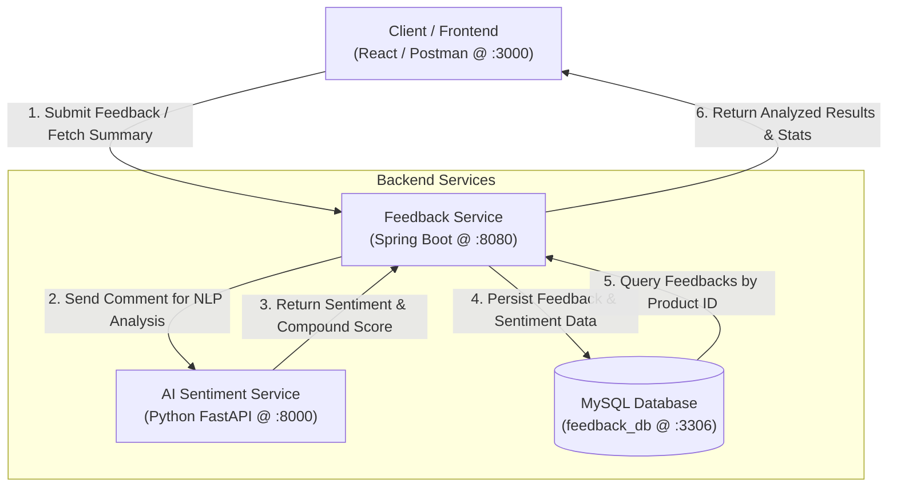

# 💬 AI-Powered Feedback Statement & Sentiment Analysis System

[](https://www.oracle.com/java/)
[](https://spring.io/projects/spring-boot)
[](https://www.python.org/)
[](https://fastapi.tiangolo.com/)
[](https://www.mysql.com/)
[](LICENSE)

An intelligent, microservice-based customer feedback management platform. It automatically processes customer reviews and feedback comments, analyzes their sentiment in real time using Natural Language Processing (NLP), and calculates product-level satisfaction statistics.

---

## 📌 System Architecture

The project is built on a **Microservices Architecture** consisting of a Spring Boot core business service, a Python AI microservice, and a MySQL relational database.



---

## ✨ Features

- **Real-Time Sentiment Analysis**: Integrates with an NLTK VADER-powered NLP service to calculate sentiment polarity (`POSITIVE`, `NEGATIVE`, `NEUTRAL`) and normalized compound scores (`-1.0` to `+1.0`).
- **Feedback Management**: Stores customer name, product identifier, feedback comments, and sentiment ratings.
- **Product Satisfaction Analytics**: Automatically computes total review counts and positive feedback percentage for any product.
- **Microservice Decoupling**: Business logic and resource-heavy AI/NLP workloads are isolated into independent services.
- **CORS Configured**: Ready to integrate with modern web frontends (configured for `http://localhost:3000`).

---

## 🛠️ Tech Stack

| Component | Technology | Description |
| :--- | :--- | :--- |
| **Backend Core** | Java 21, Spring Boot | Main REST API service handling business logic |
| **Persistence** | Spring Data JPA, Hibernate, MySQL | Database ORM and relational storage |
| **Utilities** | Project Lombok | Boilerplate code reduction |
| **HTTP Client** | `RestTemplate` | Inter-service synchronous HTTP communication |
| **AI Microservice** | Python 3, FastAPI, NLTK (VADER) | NLP Sentiment Intensity Analyzer |
| **Build Tool** | Apache Maven | Dependency management & project build |

---

## 📂 Project Structure

```text
feedback_statement_system_full/
│
├── .gitignore                                  # Git ignore rules for Maven, IDEs, and Python
├── README.md                                   # Project documentation
│
└── feedback-service/
    └── feedback-service/                       # Spring Boot Application
        ├── pom.xml                             # Maven build configuration
        ├── mvnw / mvnw.cmd                     # Maven wrapper scripts
        └── src/
            ├── main/
            │   ├── java/com/example/feedback_service/
            │   │   ├── FeedbackServiceApplication.java   # Main entry point
            │   │   ├── config/
            │   │   │   └── AppConfig.java                # RestTemplate bean configuration
            │   │   ├── controller/
            │   │   │   └── FeedbackController.java       # REST endpoints
            │   │   ├── dto/
            │   │   │   ├── AiResponseDTO.java            # AI microservice response model
            │   │   │   ├── FeedbackRequestDTO.java       # User feedback request payload
            │   │   │   └── FeedbackSummaryDTO.java       # Aggregated product summary response
            │   │   ├── entity/
            │   │   │   └── Feedback.java                 # JPA entity mapped to 'feedbacks' table
            │   │   ├── repository/
            │   │   │   └── FeedbackRepository.java       # JPA repository
            │   │   └── service/
            │   │       └── FeedbackService.java          # Service layer & business logic
            │   └── resources/
            │       └── application.properties            # Database and service configurations
            └── test/
                └── java/com/example/feedback_service/    # Unit & Integration tests
```

---

## ⚙️ Prerequisites

Before running the application, make sure you have the following installed:

1. **Java JDK 21** or later
2. **Maven 3.8+** (or use the included `./mvnw`)
3. **MySQL Server 8.0+**
4. **Python 3.9+** (for the AI microservice)

---

## 🚀 Getting Started

### 1. Database Setup

Open your MySQL client (e.g. MySQL Workbench, MySQL CLI) and create the database:

```sql
CREATE DATABASE feedback_db;
```

> **Note:** Spring Boot JPA is set to `spring.jpa.hibernate.ddl-auto=update`, which will automatically generate the required `feedbacks` table upon startup.

---

### 2. Configure Spring Boot

Check or update the database credentials in `feedback-service/feedback-service/src/main/resources/application.properties`:

```properties
server.port=8080

# MySQL Configuration
spring.datasource.url=jdbc:mysql://localhost:3306/feedback_db?useSSL=false&serverTimezone=UTC&allowPublicKeyRetrieval=true
spring.datasource.username=root
spring.datasource.password=YOUR_MYSQL_PASSWORD
spring.datasource.driver-class-name=com.mysql.cj.jdbc.Driver

# JPA / Hibernate
spring.jpa.hibernate.ddl-auto=update
spring.jpa.show-sql=true

# Python AI Microservice URL
ai.service.url=http://localhost:8000/analyze
```

---

### 3. Run the Python AI Microservice

The AI microservice performs sentiment scoring using FastAPI and NLTK VADER.

Create and run the Python service (`main.py`):

```bash
# Install dependencies
pip install fastapi uvicorn nltk pydantic

# Run the FastAPI server on port 8000
uvicorn main:app --reload --port 8000
```

*(Verify the AI service is live at `http://localhost:8000/docs`)*

---

### 4. Run the Spring Boot Service

Navigate to the Spring Boot project folder and start the service:

**Windows (PowerShell / Command Prompt):**
```powershell
cd feedback-service/feedback-service
.\mvnw.cmd spring-boot:run
```

**Linux / macOS:**
```bash
cd feedback-service/feedback-service
./mvnw spring-boot:run
```

The service will start on `http://localhost:8080`.

---

## 📡 API Reference

### 1. Submit Customer Feedback
Sends feedback to the system, evaluates its sentiment via AI, and stores it in the database.

- **URL:** `/api/feedbacks`
- **Method:** `POST`
- **Headers:** `Content-Type: application/json`

#### Request Body
```json
{
  "productId": 101,
  "customerName": "Nimal Perera",
  "comment": "The build quality is super durable and the delivery was extremely fast! Highly recommend."
}
```

#### Response (`200 OK`)
```json
{
  "id": 1,
  "productId": 101,
  "customerName": "Nimal Perera",
  "comment": "The build quality is super durable and the delivery was extremely fast! Highly recommend.",
  "sentiment": "POSITIVE",
  "compoundScore": 0.8126,
  "createdAt": "2026-11-07T18:30:15.123456"
}
```

---

### 2. Get Feedback Summary by Product
Fetches all reviews for a specific product along with total count and calculated positive feedback percentage.

- **URL:** `/api/feedbacks/product/{productId}`
- **Method:** `GET`

#### Example Request:
```bash
GET http://localhost:8080/api/feedbacks/product/101
```

#### Response (`200 OK`)
```json
{
  "feedbacks": [
    {
      "id": 1,
      "productId": 101,
      "customerName": "Nimal Perera",
      "comment": "The build quality is super durable and the delivery was extremely fast! Highly recommend.",
      "sentiment": "POSITIVE",
      "compoundScore": 0.8126,
      "createdAt": "2026-11-07T18:30:15"
    }
  ],
  "positivePercentage": 100.0,
  "totalCount": 1
}
```

---

## 🧪 Sentiment Classification Thresholds

The NLP microservice calculates a **compound score** between `-1.0` and `+1.0` using NLTK VADER:

| Compound Score Range | Sentiment Class |
| :--- | :--- |
| `score >= 0.05` | `POSITIVE` |
| `-0.05 < score < 0.05` | `NEUTRAL` |
| `score <= -0.05` | `NEGATIVE` |

---

## 📤 How to Push to Git / GitHub

Follow these steps from the root directory of this repository:

```bash
# 1. Initialize git (if not already initialized)
git init

# 2. Stage all project files (ignoring target/ and .idea/ via .gitignore)
git add .

# 3. Create your initial commit
git commit -m "Initial commit: Feedback statement and AI sentiment analysis system"

# 4. Set the main branch
git branch -M main

# 5. Link your GitHub remote repository (replace with your GitHub URL)
git remote add origin https://github.com/YOUR_USERNAME/feedback-statement-system.git

# 6. Push to GitHub
git push -u origin main
```

---

## 👨‍💻 Author

Developed as part of the **Feedback Statement System Project**.
Feel free to open an issue or pull request if you wish to contribute!

